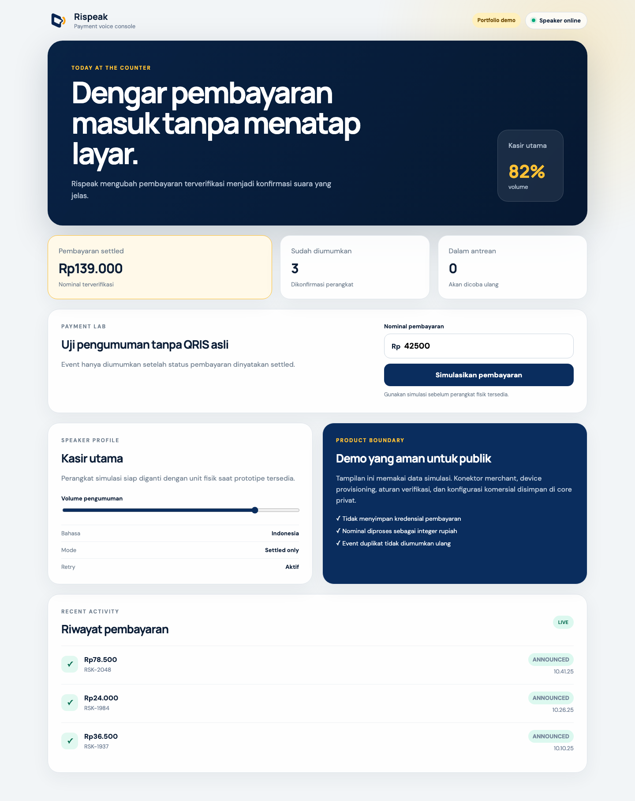
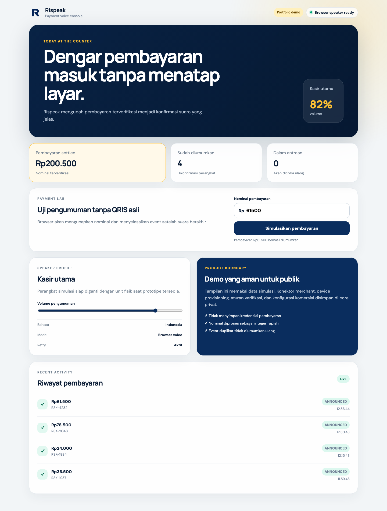
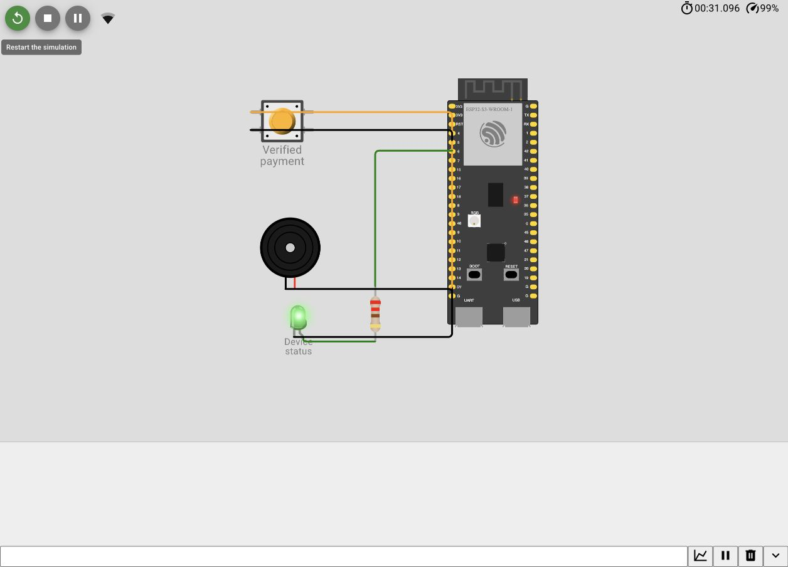
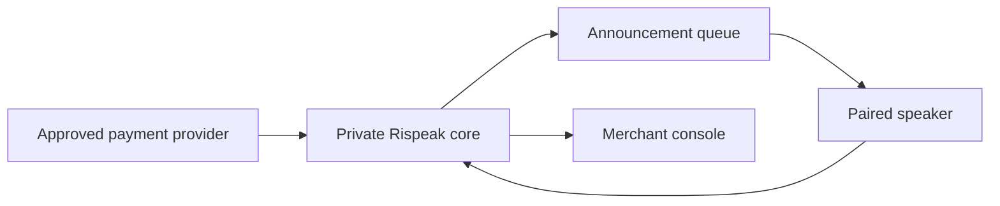

<p align="center">
  
</p>

<h1 align="center">Rispeak</h1>

<p align="center"><strong>A payment confirmation speaker that lets a busy counter hear what matters.</strong></p>

At a crowded shop, the merchant should not need to stop serving, unlock a phone, and inspect a notification every time a customer says they have paid. Rispeak turns a verified payment event into a concise voice confirmation and gives the merchant a calm console for device status, announcement history, and recovery states.

This public repository is the interactive product showcase. It proves the user journey and interface quality with deterministic simulated data while the payment connectors, verification rules, device provisioning, and commercial operations remain private.

## Product preview







## What can be evaluated

- Simulate a settled payment without entering real merchant credentials.
- Hear the amount spoken through the browser's Indonesian text-to-speech voice.
- Watch the event remain queued until speech finishes, then move to the announced state.
- Review settled volume, announced events, and queued work.
- Adjust the simulated speaker volume.
- Inspect the responsive counter experience on desktop and mobile.
- Run automated unit and browser journeys.
- Inspect and run the ESP32-S3 lifecycle simulation in Wokwi without physical hardware.

## Public system context



The current hardware boundary is intentionally replaceable. The browser validates Indonesian speech and the [Wokwi ESP32-S3 simulation](./firmware/wokwi/) validates device startup, Wi-Fi, state transitions, indicators, and playback acknowledgement. Wokwi does not emulate ESP32-S3 I2S, so physical audio quality remains a later hardware test.

## Run the showcase

Requirements: Node.js 24 and pnpm 11.

```bash
pnpm install
pnpm dev
```

Open `http://127.0.0.1:4580`.

## Quality checks

```bash
pnpm quality
pnpm test:e2e
```

The checks cover formatting, TypeScript, metric behavior, production build output, the payment simulation journey, and responsive device controls.

## Product boundary

Read [the public product boundary](./docs/product-boundary.md) before interpreting this repository. The demo does not connect to Shopee, QRIS, or any payment provider, and it does not claim production payment processing.

The [ShopeePay integration plan](./docs/shopeepay-integration.md) documents the official interfaces, credentials, verification rules, and lowest-cost path required before a real provider connection can be built.

## Status

- Software MVP: working locally with a private service core and browser speaker simulator.
- Public showcase: interactive and safe to run without credentials.
- Virtual hardware prototype: ESP32-S3 circuit and firmware prepared for Wokwi validation.
- Physical prototype: waiting for sandbox integration results, hardware selection, and purchase.
- Provider integration: waiting for access to an approved official interface.

## Rights

Copyright © 2026 Abi Eka Putra Wulyono. Source code is published for portfolio review. No license to copy, redistribute, sell, or create derivative commercial products is granted.
