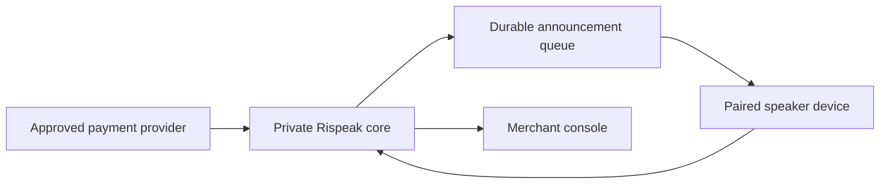

# System Context

The production direction keeps payment verification in a trusted service and gives each paired device a narrow command channel. The public application replaces those private components with a deterministic browser simulation. The Wokwi firmware validates the replaceable device lifecycle on a simulated ESP32-S3.

Wokwi validates firmware startup, Wi-Fi, input, state transitions, a buzzer output surrogate, and acknowledgement. Hardware-specific speech playback and connectivity decisions remain open until a prototype board and speaker have been selected and measured because ESP32-S3 I2S is not currently emulated.
