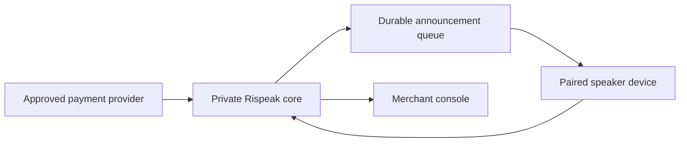

# System Context

The production direction keeps payment verification in a trusted service and gives each paired device a narrow command channel. The public application in this repository replaces those private components with a deterministic browser simulation.

Hardware-specific audio and connectivity decisions remain open until a prototype board and speaker have been selected and measured.
