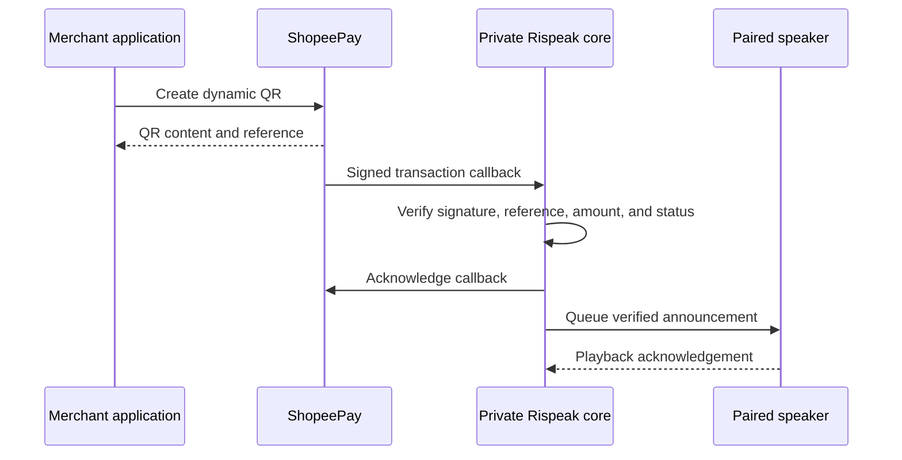

# ShopeePay Integration Plan

This document maps the official ShopeePay interfaces Rispeak would need. It does not contain credentials or claim that the current simulator processes real payments.

## Recommended payment flow

Rispeak should use Merchant Presented Mode with a dynamic QR when official API access is approved. A dynamic QR gives each order a unique reference and amount, which makes payment verification and speaker announcements safer than reacting to an unverified notification.

## Required interfaces

| Interface            | Official path                   | MVP role                                                                                 |
| -------------------- | ------------------------------- | ---------------------------------------------------------------------------------------- |
| B2B access token     | `POST /v1.0/access-token/b2b`   | Obtain the bearer token used by transaction APIs.                                        |
| Create dynamic QR    | `POST /v1.0/qr/qr-mpm-generate` | Bind a unique merchant reference and amount to a customer-facing QR.                     |
| Transaction callback | `POST /v1.0/qr/qr-mpm-notify`   | Receive the signed asynchronous payment result.                                          |
| Check transaction    | `POST /v1.0/qr/qr-mpm-query`    | Recover the latest status when a callback is missed or a transaction remains processing. |
| Invalidate QR        | `POST /v1.0/qr/qr-mpm-cancel`   | Close an expired or cancelled order so its QR cannot be reused.                          |

Refund is outside the first speaker MVP because it does not affect the incoming-payment announcement flow.

## Access and credentials

Official API access is separate from ordinary Shopee Merchant application login. ShopeePay's documented onboarding requires contacting its team, signing an NDA and commercial agreement, selecting the payment flow, and receiving testing credentials.

ShopeePay supplies a Client ID, Client Secret, and ShopeePay public key. The merchant supplies a public key and a public HTTPS callback URL while retaining its private key. The integration uses OAuth 2.0, RSA signatures for access-token requests, HMAC-SHA512 transaction signatures, and TLS 1.2 or 1.3.

Rispeak must never request or store a merchant's Shopee password, OTP, browser cookie, or personal access session.

## Verification rules

A callback is eligible for announcement only after the private core verifies all of the following:

1. The callback signature is valid.
2. The partner reference matches a known order.
3. The amount matches the original request.
4. The transaction status is successful (`latestTransactionStatus` is `00`).
5. The payment event has not already been announced.

The device command must include an integer rupiah amount. The audio adapter converts that amount into Indonesian words, such as `61500` to `Rispeak. Pembayaran diterima sebesar enam puluh satu ribu lima ratus rupiah.` An announcement is acknowledged only after playback finishes.

ShopeePay documents callbacks as one-time events without automatic retries. Rispeak therefore needs status polling and reconciliation rather than relying on the callback alone.

## Cost boundary

ShopeePay does not publish a fixed API-access or onboarding price in the integration documentation. Commercial terms, settlement terms, and any integration charge must be confirmed with ShopeePay during onboarding.

QRIS Merchant Discount Rate is a transaction cost and is separate from API access. The applicable rate depends on merchant category, transaction amount, and the current QRIS policy. It must be confirmed against the merchant agreement before production launch.

As of 23 October 2026, ShopeePay's published QRIS guidance states:

| Merchant category                              | Transaction amount | Published MDR |
| ---------------------------------------------- | -----------------: | ------------: |
| Micro business (UMI)                           |    Up to Rp500,000 |            0% |
| Micro business (UMI)                           |    Above Rp500,000 |          0.3% |
| Small, medium, or large business (UKE/UME/UBE) |    Up to Rp100,000 |            0% |
| Small, medium, or large business (UKE/UME/UBE) |    Above Rp100,000 |          0.7% |

These rates took effect on 1 October 2026 according to ShopeePay. The merchant's assigned category and signed commercial agreement remain authoritative.

## Lowest-cost validation path

1. Keep the current browser and Wokwi simulations at zero hardware cost.
2. Request official sandbox credentials and a written commercial quote from ShopeePay.
3. Implement and test the adapter against the sandbox while running the backend locally.
4. Add a temporary secure HTTPS callback tunnel only during integration testing.
5. Buy one prototype device only after sandbox callbacks and reconciliation are proven.
6. Select production hosting and hardware after measuring event volume, latency, and audio quality.

This sequence avoids buying hardware, hosting a permanent service, or paying for commercial simulation before provider access is confirmed.

## Official references

- [ShopeePay integration onboarding](https://product.shopeepay.co.id/integration/get-started/go)
- [Access Token API](https://product.shopeepay.co.id/integration/api/access-token)
- [Merchant Presented Mode APIs](https://product.shopeepay.co.id/integration/api/merchant-presented-mode)
- [Notify Transaction Status](https://product.shopeepay.co.id/integration/api/notify-transaction-status)
- [ShopeePay merchant terms](https://shopeepay.co.id/terms/merchant)
- [ShopeePay QRIS MDR guidance, effective 1 October 2026](https://shopeepay.co.id/blog/mdr-qris-0-persen)
- [Wokwi ESP32 simulation](https://docs.wokwi.com/guides/esp32)
- [Wokwi ESP32 Wi-Fi](https://docs.wokwi.com/guides/esp32-wifi)
